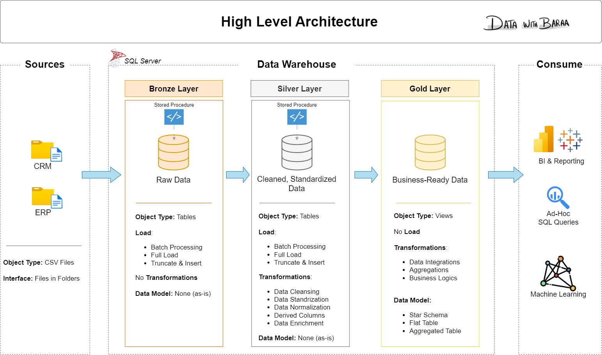

# Data Warehouse and Analytics Project

[](https://www.youtube.com/@datawithbaraa) [](https://www.udemy.com/course/building-a-modern-data-warehouse-data-engineering-bootcamp/) [](https://www.datawithbaraa.com) [](LICENSE) [](https://github.com/DataWithBaraa/sql-data-warehouse-project)

The materials of the data warehouse project: the source files, every script from the videos, and the docs.

You take raw files from two systems, a CRM and an ERP, and build one data warehouse in SQL Server. At the end, the data is clean and ready for analysis.

**New here? Open the setup guide in the `00_setup` folder.** It walks you through installing SQL Server and creating the database, on Windows and Mac, with the fixes for the common errors.

```
sql-data-warehouse-project/
├── 00_setup/               the setup guide, and the one-click Docker start for Mac
├── 01_datasets/            the six source files the project loads
│   ├── source_crm/         three files from the CRM system
│   └── source_erp/         three files from the ERP system
├── 02_docs/                the requirements, the diagrams and the notes
├── 03_scripts/             the project scripts, in the order of the videos
│   ├── init_database.sql   creates the database: run it first
│   ├── bronze/             loads the raw files
│   ├── silver/             cleans and prepares the data
│   └── gold/               builds the tables for analysis
└── 04_tests/               checks the quality of the silver and gold data
```

The project reads the six files from `C:\sql\dwh_project\01_datasets\`. Put the folder there, or change the six paths in `03_scripts/bronze/proc_load_bronze.sql`. The videos show the folders without numbers: `datasets` there is `01_datasets` here, `scripts` is `03_scripts`.

---
## 🏗️ Data Architecture

The data architecture for this project follows Medallion Architecture **Bronze**, **Silver**, and **Gold** layers:


1. **Bronze Layer**: Stores raw data as-is from the source systems. Data is ingested from CSV Files into SQL Server Database.
2. **Silver Layer**: This layer includes data cleansing, standardization, and normalization processes to prepare data for analysis.
3. **Gold Layer**: Houses business-ready data modeled into a star schema required for reporting and analytics.

---
## 📖 Project Overview

In this project, you:

1. **Design the architecture:** a modern data warehouse with three layers, bronze, silver and gold.
2. **Build the ETL pipelines:** load the source files and move the data through the layers.
3. **Model the data:** facts and dimensions, ready for reports.
4. **Analyze it:** answer business questions with SQL.

---

## 🛠️ Important Links & Tools

- **SQL Server and SSMS:** the setup guide in `00_setup` has the links and every step.
- **[Git](https://github.com/):** a GitHub account, to save and share your project.
- **[draw.io](https://www.drawio.com/):** to draw the architecture and the data model.
- **[Notion template](https://www.notion.com/templates/sql-data-warehouse-project):** the project plan, ready to copy.
- **[Notion project steps](https://thankful-pangolin-2ca.notion.site/SQL-Data-Warehouse-Project-16ed041640ef80489667cfe2f380b269?pvs=4):** every phase and task of the project.

---

## 🚀 Project Requirements

### Building the Data Warehouse (Data Engineering)

#### Objective
Develop a modern data warehouse using SQL Server to consolidate sales data, enabling analytical reporting and informed decision-making.

#### Specifications
- **Data Sources**: Import data from two source systems (ERP and CRM) provided as CSV files.
- **Data Quality**: Cleanse and resolve data quality issues prior to analysis.
- **Integration**: Combine both sources into a single, user-friendly data model designed for analytical queries.
- **Scope**: Focus on the latest dataset only; historization of data is not required.
- **Documentation**: Provide clear documentation of the data model to support both business stakeholders and analytics teams.

---

### BI: Analytics & Reporting (Data Analysis)

#### Objective
Develop SQL-based analytics to deliver detailed insights into:
- **Customer Behavior**
- **Product Performance**
- **Sales Trends**

These insights empower stakeholders with key business metrics, enabling strategic decision-making.  

For more details, refer to [02_docs/requirements.md](02_docs/requirements.md).

---

## 🎓 Learn with me

Watch on YouTube, or take the guided version with a certificate on my Academy or Udemy.

| Course | YouTube | My Academy | Udemy |
|:--|:--|:--|:--|
| **SQL** | [Full course](https://youtu.be/SSKVgrwhzus) · [Playlist](https://www.youtube.com/playlist?list=PLNcg_FV9n7qZY_2eAtUzEUulNjTJREhQe) | [Full Package](https://www.datawithbaraa.com/course/sql-full-course-for-beginners) · [Handbook](https://academy.datawithbaraa.com/l/digital_download/1087406/the-sql-handbook) | [SQL Bootcamp](https://www.udemy.com/course/the-complete-sql-bootcamp-30-hours-go-from-zero-to-hero/?referralCode=D20781228C2EB8B98339) · [SQL for Analytics](https://www.udemy.com/course/sql-mastery-for-data-analytics-and-business-intelligence/) |
| **Python** | [Full course](https://youtu.be/Rq5gJVxz55Q) · [Playlist](https://www.youtube.com/playlist?list=PLNcg_FV9n7qZGfFl2ANI_zISzNp257Lwn) | [Full Package](https://www.datawithbaraa.com/course/the-ultimate-python-mastery) · [Handbook](https://academy.datawithbaraa.com/l/digital_download/998313/the-python-handbook) | [Python Bootcamp](https://www.udemy.com/course/the-complete-python-bootcamp-13hours-go-from-zero-to-hero/?referralCode=776491A4119FF8AF41CA) |
| **Tableau** | [Full course](https://youtu.be/K3pXnbniUcM) · [Playlist](https://www.youtube.com/playlist?list=PLNcg_FV9n7qZJqrKcUUCWCWPYCrlcVm9v) | [Full Package](https://www.datawithbaraa.com/course/tableau-ultimate-full-course-for-beginners) | [Tableau Course](https://www.udemy.com/course/the-tableau-ultimate-course-from-zero-to-hero/?referralCode=6544726FDC491A6B25EC) · [Chart Masterclass](https://www.udemy.com/course/the-tableau-ultimate-chart-masterclass-63-tableau-charts/) |
| **Power BI** | [Full course](https://www.youtube.com/playlist?list=PLNcg_FV9n7qZge4KDGqGtqgiuVuhVZWzu) | | |
| **Databricks** | [Full course](https://www.youtube.com/playlist?list=PLNcg_FV9n7qZWchr-GE5iPPBmOjiffK6O) | | |

Materials on my website: [SQL](https://www.datawithbaraa.com/wiki/sql) · [Python](https://www.datawithbaraa.com/wiki/python) · [Tableau](https://www.datawithbaraa.com/wiki/tableau) · [Power BI](https://www.datawithbaraa.com/wiki/power-bi)

### The SQL projects

| Project | YouTube | Materials | Udemy |
|:--|:--|:--|:--|
| **Data Warehouse** | [Watch](https://youtu.be/9GVqKuTVANE) | this repository | [Building a Modern Data Warehouse](https://www.udemy.com/course/building-a-modern-data-warehouse-data-engineering-bootcamp/) |
| **Exploratory Data Analysis** | [Watch](https://youtu.be/6cJ5Ji8zSDg) | [Repository](https://github.com/DataWithBaraa/sql-data-analytics-project) | [SQL for Exploratory Data Analysis](https://www.udemy.com/course/sql-for-exploratory-data-analysis-eda-real-world-project/) |
| **Advanced Data Analytics** | [Watch](https://youtu.be/2jGhQpbzHes) | same repository | |

More on YouTube: [Data projects](https://www.youtube.com/playlist?list=PLNcg_FV9n7qZ4Ym8ZriYT6WF8TaC2e_R7) · [Data careers](https://www.youtube.com/playlist?list=PLNcg_FV9n7qah95jp-aPtysu7kFCbg7hd)

## 🤝 Connect

[](https://www.linkedin.com/in/baraa-khatib-salkini/) [](https://discord.gg/gsVJbMxKcA) [](https://www.instagram.com/datawithbaraa/) [](https://www.tiktok.com/@datawithbaraa) [](https://www.blog.datawithbaraa.com) [](https://www.notion.com/@datawithbaraa)

## 🛡️ License

[MIT](LICENSE). Use it, change it, share it, with attribution.

## 🌟 About me

Hi, I'm **Baraa Khatib Salkini**. I spent years in enterprise data engineering and built one of the largest lakehouses at Mercedes-Benz. Today I teach data full-time at **Data With Baraa**: visually, step by step, from zero to hero.
